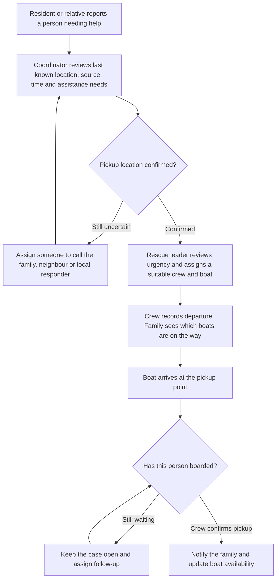

# Flood Rescue Map Malaysia

**Flood Rescue Map is a proposed coordination tool that helps rescue leaders decide where to send the next available boat and keeps families informed until their loved one’s pickup is confirmed.** Residents can also use the map to find open evacuation centres, report local hazards, and check power restoration updates.

## Problem statement

During a flood, a family may know that someone needs help but have only an old address or an unconfirmed location. A rescue coordinator then has to establish **where the person is now, how urgent the situation is, what assistance they need to board, and which crew can reach them**. This is especially important when an older resident cannot use a smartphone or a person with a disability (*Orang Kurang Upaya*, OKU) needs an accessible pickup. Even after a boat is assigned, the family still needs to know whether it has departed, arrived, or actually picked up their relative.

**The design question:** How can a district rescue coordinator turn an incomplete report into a verified pickup, while giving the family accurate updates during an outage?

Malaysia recorded **RM636.9 million in flood losses in 2025**. Existing services already cover parts of the response: SaveME 999 supports emergency reporting, Public InfoBanjir publishes river conditions, and MyIBJKM helps households find and register at evacuation centres. The proposed project focuses on the handover **from a family’s report to an individual’s confirmed pickup**. Whether this is a significant gap in a particular district should be validated with its responders. [DOSM flood losses](https://www.dosm.gov.my/uploads/content-downloads/file_20260415121023.pdf) · [NG MERS 999](https://www.tm.com.my/news/next_gen_999) · [Public InfoBanjir](https://publicinfobanjir.water.gov.my/cerapan/amaran-semasa/?lang=en) · [MyIBJKM](https://www.malaysia.gov.my/my/topics/aplikasi-myibjkm-untuk-mangsa-bencana)

## How the rescue works

## Resident and admin features

| Feature | Residents and families | Coordinators, crews and utility staff |
|---|---|---|
| **Local flood, outage and shelter map** | Search by area or postcode for power outages, confirmed causes, estimated restoration times, and nearby temporary evacuation centres (*PPS*). Check opening status, accessibility, available supplies and reported road closures. | Verify and publish local reports. Shelter staff update capacity and services. A utility liaison updates the repair status and restoration estimate. Each update carries a time and source. |
| **Local reports and family-assisted SOS** | Report a blocked road or power outage, or select **“Someone else needs rescue.”** Enter the affected person’s last known location, landmark, last contact time and assistance needs. A photo is optional. | Keep the reporter’s callback details separate from the affected person’s location. Verify uncertain addresses, update the pickup pin when someone moves, and assign an owner to unresolved cases. |
| **OKU support and rescue priority** | Describe practical needs such as wheelchair boarding assistance, difficulty using stairs, or a preference for text communication. A relative can submit the request without the affected person having an account. | Review immediate danger, ability to evacuate, support on site, terrain, river trends and field reports. A low-lying village that has lost contact can be flagged for a welfare check. The rescue leader confirms priority and equipment. |
| **Boats, crews and supplies** | See how many boats are assigned to the household’s pickup point, how many are on the way, and when each position was last confirmed. | Locate and assign available boats, crews, life jackets, generators and drinking water. Track each resource through preparation, departure, arrival and handover. |
| **Two-way updates and privacy** | Report a changed location and receive private pickup updates. Area-wide notices cover shelter openings and power repairs. If a report is saved offline, the screen shows **“Waiting to send.”** | Restrict exact household locations and callback numbers to authorised responders. Distinguish a received report, an assigned crew, a departed boat and a confirmed pickup. |

## What the family sees

In a **fictional demo**, a daughter reports that her mother, who uses a wheelchair, was last seen at her flat. A neighbour confirms she has since moved to the covered school entrance. The coordinator updates the pin and records the boarding assistance needed. Several households are waiting at that entrance, so the daughter’s screen shows both the boat movements and **her mother’s individual status**.

> **Pickup point — Covered school entrance**  
> **3 boats assigned · 2 on the way · 1 preparing**  
> 🚤 Boat 04 · On the way · Position updated at 2:32 PM  
> 🚤 Boat 07 · On the way · Position updated at 2:34 PM  
> Boat 12 · Preparing to depart  
> **Your mother — Awaiting pickup**

Each travelling boat has its own map icon. If connectivity drops, the icon retains its last confirmed timestamp. When Boat 04 reaches the school, the family sees **“Boat arrived.”** When the crew confirms that the mother has boarded, her case changes to **“Pickup confirmed.”**

## How to demonstrate its value

| Competition requirement | What to show the judges |
|---|---|
| **Continuity planning** | Disconnect a device. The crew can still read its saved assignment, and an unsent update stays visibly queued until connectivity returns. |
| **Rapid response** | Give the coordinator two simultaneous requests and one available boat. Show how they dispatch the boat to a verified pickup and assign someone to check the unresolved request. |
| **Data protection** | Open the public map and the authorised crew view. Only the assigned responders can see the family’s callback details and precise pickup location. |
| **Community support** | Let a relative in another town submit the request, identify an accessibility need, and receive confirmation without requiring the affected person to use a phone. |

For the **first prototype**, use one district, two PPS locations, three simulated boats and manually updated crew statuses. Compare it with a paper-and-phone drill using three measures: **time to verify the pickup point, duplicate boat assignments, and households still waiting that were incorrectly marked as rescued**. These give the team a credible *before-and-after* slide once the drill has been run.